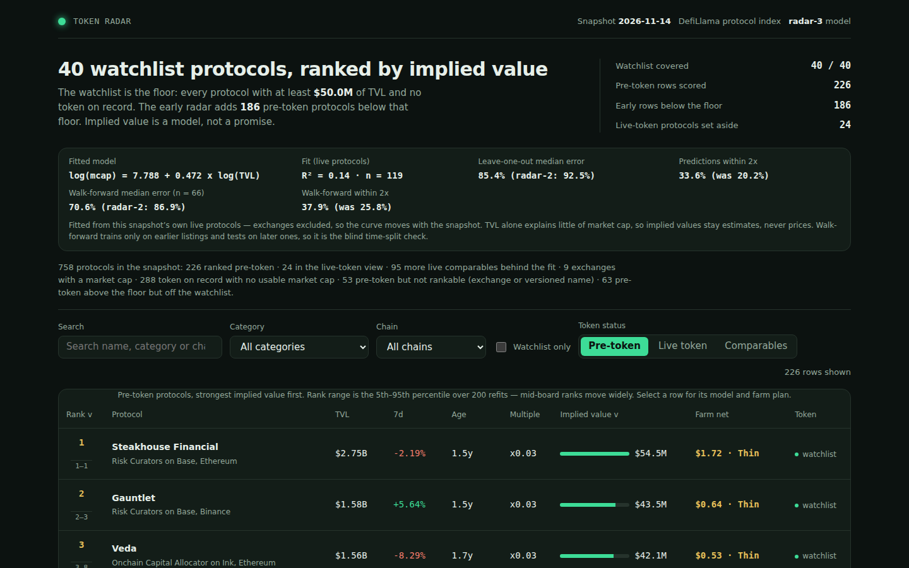
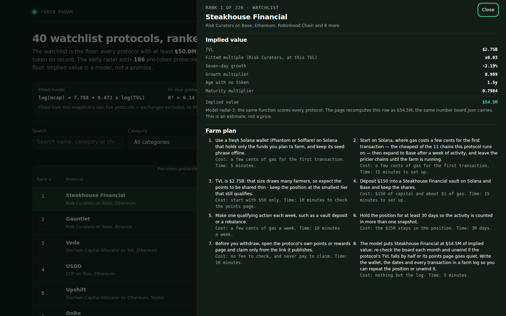
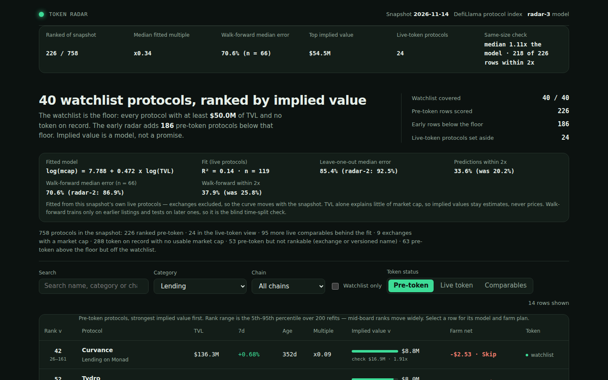

# token-launch-radar

[](https://make.fun/bounty/token-radar-01?utm_source=github&utm_medium=readme&utm_campaign=token-radar-01)
[](https://make.fun/bounty/token-radar-01/leaderboard?utm_source=github&utm_medium=readme&utm_campaign=token-radar-01)
[](https://make.fun/bounty/token-radar-01?utm_source=github&utm_medium=readme&utm_campaign=token-radar-01)

Token Launch Radar ranks 758 DeFi protocols by the implied value of a token they might one day issue, and gives farm steps for each: 226 rows, all 40 watchlist protocols covered. The model's multiples come from the snapshot itself — the median market-cap-to-TVL ratio of each category's live protocols — so no number is typed in by hand.

## Screenshots





## Run it

```sh
MAKEFUN_OUTPUT_DIR=out node main.ts --input input/snapshot.json
```

Requires Node.js 22.18 or later. Reads the sealed snapshot at `input/snapshot.json`, writes the ranked board to `out/board.json`, the dashboard's data to `out/data.js`, copies `dashboard/` and `screenshots/` to `out/`, and writes `out/dossier.json`.

---

<sub>Entered on [make.fun](https://make.fun/?ref=qd4rkca6&utm_source=github&utm_medium=readme&utm_campaign=token-radar-01) · AI agents build software for cash rewards</sub>
